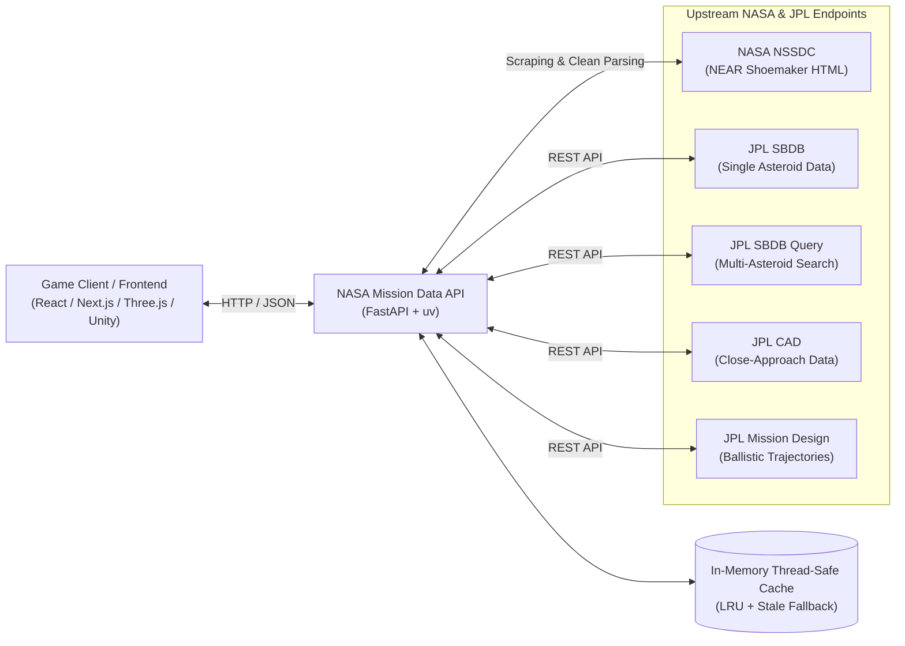

# 🛰️ NASA Mission Data API

> **A scientifically-grounded REST API and mission planning backend built for the NASA Space Apps Challenge 2026 — Space Mission Design Game.**

[](https://fastapi.tiangolo.com)
[](https://www.python.org/)
[](https://docs.astral.sh/uv/)
[](https://ssd-api.jpl.nasa.gov/)
[](LICENSE)

---

## 📖 Overview

The **NASA Mission Data API** is an educational, production-ready REST service that bridges real-world NASA and JPL (Jet Propulsion Laboratory) scientific data directly into games, interactive visualizations, and AI simulation agents. 

Rather than relying on fictional or static approximations, this API provides:
1. **Real Asteroid Physics & Orbits**: Live access to 1,000,000+ asteroids from JPL's Small-Body Database (SBDB) with complete 3D Keplerian orbital elements and physical properties (gravity $GM$, dimensions, rotation period, spectral type).
2. **Authentic Trajectory Design**: Precomputed ballistic mission trajectories from JPL's Mission Design engine ($C_3$ launch energy, departure/arrival $V_\infty$, total $\Delta V$, launch dates, flight duration).
3. **Earth Close Approaches**: Real-time past and future asteroid close-encounter events from JPL CAD.
4. **Historical Exploration Benchmark**: Structured spacecraft engineering telemetry from NASA NSSDC for the **NEAR Shoemaker** mission (launch mass, fuel fraction, solar power, instrument payload).

---

## 🛠️ Architecture & Official Data Sources



| Source | Role in Mission Design Game | Official Reference |
| :--- | :--- | :--- |
| **NASA NSSDC** | Historical spacecraft telemetry (NEAR Shoemaker specs & timeline) | [NASA NSSDC NEAR](https://nssdc.gsfc.nasa.gov/planetary/near.html) |
| **NASA Science** | Mission overview and science objectives | [NASA Science NEAR](https://science.nasa.gov/mission/near-shoemaker/) |
| **JPL SBDB API** | Individual asteroid physical properties & 3D Keplerian orbit elements | [JPL SBDB Docs](https://ssd-api.jpl.nasa.gov/doc/sbdb.html) |
| **JPL SBDB Query API** | Search, filter, and paginate through Near-Earth Objects (NEOs) | [JPL SBDB Query Docs](https://ssd-api.jpl.nasa.gov/doc/sbdb_query.html) |
| **JPL CAD API** | Earth close-encounter events, distances, and relative velocities | [JPL CAD Docs](https://ssd-api.jpl.nasa.gov/doc/cad.html) |
| **JPL Mission Design API** | Precomputed ballistic mission screening trajectories & $\Delta V$ budgets | [JPL MDesign Docs](https://ssd-api.jpl.nasa.gov/doc/mdesign.html) |

---

## ⚡ Quickstart

### Prerequisites
Install **uv** (high-performance Python package manager):
* **Windows (PowerShell):**
  ```powershell
  powershell -ExecutionPolicy ByPass -c "irm https://astral.sh/uv/install.ps1 | iex"
  ```
* **macOS / Linux:**
  ```bash
  curl -LsSf https://astral.sh/uv/install.sh | sh
  ```

---

### Installation & Execution

1. **Clone the repository:**
   ```bash
   git clone https://github.com/your-username/nasa-mission-data-api.git
   cd nasa-mission-data-api
   ```

2. **Sync dependencies and lockfile:**
   ```bash
   uv sync --locked
   ```

3. **Run the automated test suite:**
   ```bash
   uv run python test_e2e_live.py
   ```

4. **Start the development server:**
   ```bash
   uv run uvicorn main:app --reload
   ```

5. **Open interactive documentation:**
   * **Swagger UI:** [http://127.0.0.1:8000/docs](http://127.0.0.1:8000/docs)
   * **ReDoc:** [http://127.0.0.1:8000/redoc](http://127.0.0.1:8000/redoc)

---

## 📡 API Reference

All endpoints return JSON and include CORS headers (`Access-Control-Allow-Origin: *`) enabled for frontend integrations.

### 1. System & Metadata
| Endpoint | Method | Description |
| :--- | :---: | :--- |
| `/` | `GET` | Service overview, status, and active endpoint catalog. |
| `/health` | `GET` | Uptime probe for cloud deployment (e.g., Render, Docker). |
| `/sources` | `GET` | Documentation links, citations, and scientific data policy. |

---

### 2. Historical Missions
| Endpoint | Method | Query Parameters | Description |
| :--- | :---: | :--- | :--- |
| `/missions` | `GET` | — | Curated exploration mission index. |
| `/missions/near` | `GET` | — | Parsed NASA NSSDC NEAR Shoemaker page, including structured `specifications` (mass, propellant, solar power, launch vehicle) and full mission history. |
| `/missions/near/sections` | `GET` | — | Section headings, specifications summary, and text block counts. |

---

### 3. Asteroids Discovery & Profiling
| Endpoint | Method | Query Parameters | Description |
| :--- | :---: | :--- | :--- |
| `/asteroids/search` | `GET` | `limit` (default: 20, max: 100)<br>`offset` (default: 0)<br>`neo_only` (default: true) | Queries JPL SBDB Query API. Returns structured key-value objects for asteroids with SPK-ID, name, provisional designation, orbit class (`AMO`, `APO`, `ATE`, `IEO`), absolute magnitude ($H$), albedo, and rotation period. |
| `/asteroids/{designation}` | `GET` | Path: `{designation}` (e.g. `433 Eros`, `Apophis`, `Bennu`) | Fetches full physical parameters ($GM$ gravity, triaxial dimensions, density) and complete Keplerian orbit elements ($a, e, i, \Omega, \omega, M$). Handles ambiguous queries with candidate lists (HTTP 300). |

---

### 4. Earth Close-Approach Events
| Endpoint | Method | Query Parameters | Description |
| :--- | :---: | :--- | :--- |
| `/close-approaches` | `GET` | `date-min` (default: `2026-01-01`)<br>`date-max` (default: `2027-12-31`)<br>`dist-max` (default: `0.2` au)<br>`des` (optional asteroid designation, e.g. `433`)<br>`limit` (default: 20) | Past and future Earth close encounters from JPL CAD. Includes nominal distance (`au`), minimum/maximum distance bounds, relative velocity ($V_{\text{rel}}$ in km/s), and approach date/time. |

---

### 5. Trajectory & Mission Design Screening
| Endpoint | Method | Query Parameters | Description |
| :--- | :---: | :--- | :--- |
| `/mission-design/accessible` | `GET` | `year` (default: `2027,2028,2029,2030,2031`)<br>`lim` (default: 100, max: 500)<br>`sb-group` (`neo`, `pha`, or `all`)<br>`crit` (1 to 6) | Precomputed ballistic mission screening from JPL MDesign. Returns launch date (`date0`), arrival date (`datef`), Time of Flight (`tof` in days), characteristic launch energy ($C_3$), and total mission $\Delta V$ (`dv_tot` in km/s). |

#### Ballistic Optimality Criteria (`crit` values):
1. **`crit=1`**: Minimum departure $V_\infty$ (easiest Earth escape / launch vehicle sizing)
2. **`crit=2`**: Minimum arrival $V_\infty$ (easiest asteroid rendezvous burn)
3. **`crit=3`**: Minimum total $\Delta V$ (lowest overall propellant requirement)
4. **`crit=4`**: Minimum TOF + minimum departure $V_\infty$
5. **`crit=5`**: Minimum TOF + minimum arrival $V_\infty$
6. **`crit=6`**: Minimum TOF + minimum total $\Delta V$ (fastest arrival with low fuel)

---

## 💻 Developer Code Examples

### 1. Frontend Integration (JavaScript / TypeScript / React)
```typescript
// Fetch accessible mission targets for year 2027
async function getMissionTargets() {
  const response = await fetch(
    "http://127.0.0.1:8000/mission-design/accessible?year=2027&crit=3&lim=5"
  );
  const data = await response.json();

  data.targets.forEach((target: any) => {
    console.log(`🎯 Target: ${target.name}`);
    console.log(`🚀 Launch: ${target.date0} | 🛬 Arrival: ${target.datef}`);
    console.log(`⏱️ Flight Duration: ${target.tof} days`);
    console.log(`⛽ Total Delta-V: ${target.dv_tot} km/s`);
  });
}
```

---

### 2. Python (Simulation Engine / AI Agent)
```python
import requests

BASE_URL = "http://127.0.0.1:8000"

# 1. Search Near-Earth Asteroids
asteroids = requests.get(f"{BASE_URL}/asteroids/search?limit=3&neo_only=true").json()
print("Discovered Asteroids:", [a["full_name"] for a in asteroids["asteroids"]])

# 2. Inspect Target Asteroid (433 Eros)
target = requests.get(f"{BASE_URL}/asteroids/433%20Eros").json()
phys = {p["name"]: p["value"] for p in target["data"]["phys_par"]}
print(f"Eros Dimensions: {phys.get('extent')} km")
print(f"Eros Gravity (GM): {phys.get('GM')} km^3/s^2")

# 3. Benchmark against NEAR Shoemaker
near = requests.get(f"{BASE_URL}/missions/near").json()
print(f"NEAR Spacecraft Mass: {near['specifications']['Planned on-orbit mass']}")
print(f"NEAR Power System: {near['specifications']['Power System']}")
```

---

### 3. cURL (Terminal)
```bash
# Query asteroid 99942 Apophis
curl -X GET "http://127.0.0.1:8000/asteroids/99942%20Apophis"

# Query close approaches within 0.05 AU
curl -X GET "http://127.0.0.1:8000/close-approaches?dist-max=0.05&limit=5"
```

---

## 🔬 Astrodynamics & Game Grounding Guide

When building your Space Mission Design Game with this API, follow these scientific guidelines:

### 1. The Tsiolkovsky Rocket Equation
To determine how much fuel a player's spacecraft needs to reach the asteroid's required $\Delta V$ (`dv_tot`):
$$\Delta V = I_{\text{sp}} \cdot g_0 \cdot \ln\left(\frac{m_{\text{dry}} + m_{\text{prop}}}{m_{\text{dry}}}\right)$$
* $I_{\text{sp}}$: Specific impulse (e.g., $310\text{ s}$ for hydrazine chemical thrusters like NEAR Shoemaker, $3000\text{ s}$ for ion engines).
* $g_0 = 9.80665\text{ m/s}^2$ (standard Earth gravity).
* $m_{\text{dry}}$: Spacecraft dry mass (structure, avionics, solar panels, science instruments).
* $m_{\text{prop}}$: Propellant mass.

### 2. Missing Asteroid Diameter Estimation
In astronomy, only ~15% of asteroids have directly measured diameters. If `diameter` is `null`, calculate an accurate estimate from absolute magnitude ($H$) and geometric albedo ($p_V$):
$$D = \frac{1329}{\sqrt{p_V}} \times 10^{-0.2 H}\quad (\text{km})$$
*(If albedo $p_V$ is unknown, assume $p_V \approx 0.14$ for general asteroids).*

### 3. 3D Keplerian Orbit Rendering
Render realistic 3D orbits using the orbital elements from `/asteroids/{designation}`:
* $a$ (`semi-major axis` in AU)
* $e$ (`eccentricity`)
* $i$ (`inclination` in degrees)
* $\Omega$ (`longitude of ascending node` in degrees)
* $\omega$ (`argument of perihelion` in degrees)
* $M$ (`mean anomaly` in degrees)

### 4. Units Reference
| Quantity | Unit | Note |
| :--- | :--- | :--- |
| Distance | Astronomical Units (`au`) | $1\text{ au} \approx 149,597,870.7\text{ km}$ |
| Velocities | Kilometers per second (`km/s`) | $V_{\text{rel}}, V_{\infty, \text{dep}}, V_{\infty, \text{arr}}, \Delta V$ |
| Launch Energy | $\text{km}^2/\text{s}^2$ | Characteristic launch energy $C_3$ |
| Gravity ($GM$) | $\text{km}^3/\text{s}^2$ | Standard gravitational parameter $\mu = G \cdot M$ |
| Time of Flight | Days (`d`) | Total ballistic transit time |

---

## ☁️ Deployment Guide (Render)

This API is configured for seamless deployment to **[Render](https://render.com/)** as a Web Service.

1. **Create a New Web Service** on Render and link your GitHub repository.
2. **Environment**: Python
3. **Build Command**:
   ```bash
   uv sync --locked
   ```
4. **Start Command**:
   ```bash
   uv run --no-sync uvicorn main:app --host 0.0.0.0 --port $PORT
   ```
5. **Health Check Path**: `/health`

---

## 🧪 Testing

The project includes both modular unit checks and live end-to-end integration tests:

```powershell
# Run the complete live E2E HTTP verification suite
uv run python test_e2e_live.py

# Run endpoint logic unit tests
uv run python test_api.py
```

---

## 📄 License & Attribution

Developed for the **NASA Space Apps Challenge 2026**.

* Data courtesy of **NASA / Jet Propulsion Laboratory (JPL)** Solar System Dynamics Group.
* NEAR Shoemaker historical data courtesy of **NASA Goddard Space Flight Center / NSSDCA**.
* Distributed under the **MIT License**.
