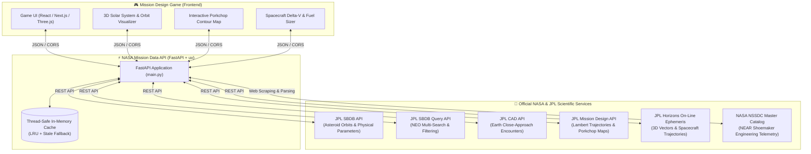

# 🛰️ NASA Mission Data API

> **A scientifically-grounded REST API and mission planning backend built for the NASA Space Apps Challenge 2026 — Space Mission Design Game.**

[](https://fastapi.tiangolo.com)
[](https://www.python.org/)
[](https://docs.astral.sh/uv/)
[](https://nasa-mission-data-api.vercel.app)
[](https://ssd-api.jpl.nasa.gov/)
[](https://www.spaceappschallenge.org/)
[](LICENSE)

---

## 🌐 Live Production Links

* 🚀 **Production API Base URL:** [https://nasa-mission-data-api.vercel.app](https://nasa-mission-data-api.vercel.app)
* 📖 **Interactive Swagger UI:** [https://nasa-mission-data-api.vercel.app/docs](https://nasa-mission-data-api.vercel.app/docs)
* 📑 **ReDoc Documentation:** [https://nasa-mission-data-api.vercel.app/redoc](https://nasa-mission-data-api.vercel.app/redoc)
* 📄 **OpenAPI JSON Schema:** [https://nasa-mission-data-api.vercel.app/openapi.json](https://nasa-mission-data-api.vercel.app/openapi.json)
* 🐙 **GitHub Repository:** [https://github.com/Mahbub0001/nasa-mission-data-api](https://github.com/Mahbub0001/nasa-mission-data-api)

---

## 🎮 Game Concept & Architecture

In the **Space Mission Design Game**, players step into the shoes of a NASA Flight Dynamics Officer and Mission Architect. Players select real asteroids, design interplanetary trajectories, size spacecraft propellant and power systems, optimize launch windows using Porkchop plots, and simulate authentic missions across the Solar System.

Rather than relying on fictional numbers or arcade physics, this backend directly connects players and game engines to **NASA and JPL's live solar system databases**.



---

## 🤖 Building the Game with AI Agents & Autonomous Copilots

If you are developing this game with an AI coding agent or copilot, you can pass this repository URL or this `README.md` directly into the agent. The agent will have 100% of the context required to scaffold game components without guessing.

### 📋 Ready-to-Use Agent Prompts

Copy and paste these prompts into your AI coding assistant to build specific game modules:

#### Prompt 1: 3D Solar System & Asteroid Orbit Viewer
> *"Using Three.js (or @react-three/fiber), build an interactive 3D Solar System orbit viewer. Call `GET https://nasa-mission-data-api.vercel.app/asteroids/{designation}` to fetch the 6 Keplerian orbital elements (`semi-major axis` $a$, `eccentricity` $e$, `inclination` $i$, `ascending node` $\Omega$, `argument of perihelion` $\omega$, `mean anomaly` $M$). Render the Sun at the origin, Earth's orbit, and the target asteroid's elliptical trajectory in 3D space with interactive camera controls (pan, zoom, orbit). Display the physical radius and rotation period in a HUD overlay."*

#### Prompt 2: Interactive Porkchop Plot & Launch Window Selector
> *"Build an interactive contour Porkchop plot component for the mission design game. Call `GET https://nasa-mission-data-api.vercel.app/mission-design/porkchop?designation=433&span=90&step=15`. Parse the 2D matrices `vinf_dep_grid` and `vinf_arr_grid` with x-axis as departure date (`mjd_dep_range`) and y-axis as Time of Flight (`tof_range`). Render a color-coded contour map where blue regions indicate minimum $\Delta V$. When the player clicks on a grid coordinate, calculate the total launch energy $C_3 = V_{\infty, \text{dep}}^2$ and select that launch opportunity for their mission plan."*

#### Prompt 3: Spacecraft Mass & Propellant Budget Calculator
> *"Build a spacecraft engineering sizing panel. Call `GET https://nasa-mission-data-api.vercel.app/missions/near` to fetch real NASA spacecraft baseline telemetry (dry mass: 805 kg, propellant: hydrazine $I_{\text{sp}} = 310\text{ s}$, solar power: 1800 W). Let the player design their own spacecraft by selecting science instruments, fuel tanks, and thrusters (Chemical Hydrazine $I_{\text{sp}}=310\text{ s}$ vs. Solar Electric Ion $I_{\text{sp}}=3000\text{ s}$). Use the Tsiolkovsky Rocket Equation to calculate whether their propellant mass fraction $\frac{m_{\text{prop}}}{m_{\text{total}}}$ is sufficient to supply the required mission $\Delta V$ (`dv_tot`) fetched from `GET /mission-design/accessible`."*

#### Prompt 4: Real-Time Historical Flight Replay (NEAR Shoemaker / OSIRIS-REx)
> *"Create a mission replay mode. Call `GET https://nasa-mission-data-api.vercel.app/ephemeris/spacecraft/near-shoemaker?start_date=1996-02-18&stop_date=1996-03-01&step_size=1%20d`. Parse the 3D Cartesian coordinates ($X, Y, Z$ in km) and velocity components ($V_x, V_y, V_z$ in km/s). Animate the spacecraft's historic trajectory leaving Earth towards 433 Eros with a scrubber timeline control, speed multiplier (1x, 10x, 100x), and live distance readouts in AU and kilometers."*

---

## 🎯 Master Gameplay-to-API-to-NASA Mapping Table

| Game Phase / Feature | API Endpoint | Query / Path Parameters | Upstream Official NASA / JPL Source | Official Documentation Link | Gameplay Mechanics & Output |
| :--- | :--- | :--- | :--- | :--- | :--- |
| **1. Target Discovery & Catalog** | `GET /asteroids/search` | `limit=20`<br>`offset=0`<br>`neo_only=true` | **JPL SBDB Query API** | [JPL SBDB Query Documentation](https://ssd-api.jpl.nasa.gov/doc/sbdb_query.html) | Mission target browser. Returns asteroid name, designation, orbit class (`AMO`, `APO`, `ATE`), absolute magnitude $H$, and rotation period. |
| **2. Target Profiling & 3D Orbit** | `GET /asteroids/{designation}` | Path: `designation`<br>*(e.g., `433`, `Apophis`, `Bennu`)* | **JPL SBDB API** | [JPL SBDB Documentation](https://ssd-api.jpl.nasa.gov/doc/sbdb.html) | Target details: Gravitational parameter $GM$, physical dimensions, density, complete Keplerian elements ($a, e, i, \Omega, \omega, M$), discovery credits, and estimated diameter. |
| **3. Planetary Defense Radar** | `GET /close-approaches` | `date-min=YYYY-MM-DD`<br>`date-max=YYYY-MM-DD`<br>`dist-max=0.2`<br>`limit=20` | **JPL CAD API** | [JPL CAD Documentation](https://ssd-api.jpl.nasa.gov/doc/cad.html) | Threat radar & rendezvous opportunities: Encounters within Lunar Distance / AU, relative velocity $V_{\text{rel}}$, and closest approach timestamp. |
| **4. Trajectory Screening & Delta-V** | `GET /mission-design/accessible` | `year=2027,2028`<br>`sb-group=neo`<br>`crit=3`<br>`lim=50` | **JPL Mission Design API (Mode A)** | [JPL MDesign Documentation](https://ssd-api.jpl.nasa.gov/doc/mdesign.html) | Mission opportunity search. Returns launch date (`date0`), arrival date (`datef`), flight duration (`tof`), launch energy ($C_3$), and total $\Delta V$ (`dv_tot`). |
| **5. Interactive Porkchop Plot** | `GET /mission-design/porkchop` | `designation=433`<br>`mjd0=60000`<br>`span=60`<br>`tof-min=100`<br>`tof-max=400`<br>`step=15` | **JPL Mission Design API (Mode M)** | [JPL MDesign Documentation](https://ssd-api.jpl.nasa.gov/doc/mdesign.html) | 2D Lambert transfer map. Returns `vinf_dep_grid` and `vinf_arr_grid` velocity contour matrices, departure dates, flight times, and the lowest $\Delta V$ optimal mission. |
| **6. High-Precision 3D Ephemeris** | `GET /ephemeris/vectors` | `target=433`<br>`start_date=2027-01-01`<br>`stop_date=2027-01-10`<br>`step_size=1 d`<br>`center=@sun` | **JPL Horizons System** | [JPL Horizons Documentation](https://ssd-api.jpl.nasa.gov/doc/horizons.html) | Relativistic n-body Cartesian positions ($X, Y, Z$ in km), velocities ($V_x, V_y, V_z$ in km/s), light-time, and range in AU. |
| **7. Real Spacecraft Replay** | `GET /ephemeris/spacecraft/{mission_name}` | Path: `near-shoemaker`, `osiris-rex`, `dart`, `voyager-1`, `voyager-2`<br>`start_date`, `stop_date`, `step_size` | **JPL Horizons Spacecraft Ephemerides** | [JPL Horizons Documentation](https://ssd-api.jpl.nasa.gov/doc/horizons.html) | Historical flight path vectors of celebrated NASA robotic explorers for in-game flight path comparison and replay. |
| **8. Spacecraft Engineering Sizing** | `GET /missions/near` | None | **NASA NSSDC Master Catalog** | [NASA NSSDC NEAR Shoemaker](https://nssdc.gsfc.nasa.gov/planetary/near.html)<br>[NASA Science NEAR](https://science.nasa.gov/mission/near-shoemaker/) | Engineering baseline: Launch mass (805 kg), hydrazine propellant fraction, dual solar array power (1800 W at 1 AU), launch vehicle (Delta 7925-8), and instruments. |

---

## 📡 Exhaustive API Endpoint Reference

All endpoints return JSON and are CORS-enabled (`Access-Control-Allow-Origin: *`) for immediate browser and game-engine consumption.

### 1. System & Metadata

#### `GET /`
Returns service metadata, version, and the full catalog of accessible endpoints.
```bash
curl -X GET "https://nasa-mission-data-api.vercel.app/"
```

#### `GET /health`
Uptime and readiness probe for Vercel, Docker, and monitoring agents.
```json
{
  "status": "ok",
  "service": "NASA Mission Data API",
  "version": "1.2.0"
}
```

#### `GET /sources`
Lists all official NASA and JPL upstream data sources, API documentation links, and public domain scientific citations.

---

### 2. Asteroids Discovery & Profiling

#### `GET /asteroids/search`
Queries JPL's Small-Body Database Query API. Allows paginated filtering by Near-Earth Object (NEO) classification.

**Parameters:**
* `limit` (*integer*, optional, default: `20`, max: `100`): Number of asteroids to return.
* `offset` (*integer*, optional, default: `0`): Pagination offset.
* `neo_only` (*boolean*, optional, default: `true`): If `true`, restricts results to Near-Earth Asteroids (`sb-group=neo`). If `false`, includes all small bodies.

**Live Example Request:**
```bash
curl -X GET "https://nasa-mission-data-api.vercel.app/asteroids/search?limit=2&neo_only=true"
```
**Sample Response:**
```json
{
  "source": "NASA JPL Small-Body Database Query API (SBDB Query)",
  "source_url": "https://ssd-api.jpl.nasa.gov/sbdb_query.api",
  "count": 2,
  "limit": 2,
  "offset": 0,
  "asteroids": [
    {
      "spkid": "2000433",
      "full_name": "433 Eros (A898 PA)",
      "pdes": "433",
      "name": "Eros",
      "orbit_class": "AMO",
      "h": 10.4,
      "diameter_km": 16.84,
      "albedo": 0.25,
      "rot_per_hr": 5.27
    }
  ]
}
```

---

#### `GET /asteroids/{designation}`
Fetches comprehensive scientific and physical data for a single asteroid or comet from JPL SBDB.

**Path Parameter:**
* `designation` (*string*): Asteroid number, name, or SPK-ID (e.g., `433`, `Eros`, `99942`, `Apophis`, `101955`, `Bennu`).

**Key Returned Objects:**
* `data.phys_par`: Gravitational parameter $GM$ ($\text{km}^3/\text{s}^2$), dimensions, geometric albedo, rotation period, spectral type.
* `data.orbital_elements`: Complete 3D Keplerian orbital elements ($a, e, i, \Omega, \omega, M$) with epoch and physical units.
* `discovery`: Discovery date, discoverer credit, and observatory site.
* `estimated_diameter_km`: Automatically computed diameter via standard asteroid magnitude-albedo relationship if empirical diameter is unlisted.
* `ca_data`: Historical and future Earth close encounters.

**Live Example Request:**
```bash
curl -X GET "https://nasa-mission-data-api.vercel.app/asteroids/433%20Eros"
```

---

### 3. Earth Close-Approach Radar

#### `GET /close-approaches`
Queries JPL's Close-Approach Data (CAD) API for past and upcoming encounters between small bodies and Earth.

**Parameters:**
* `date-min` (*string*, default: `2026-01-01`): Earliest encounter date (`YYYY-MM-DD`).
* `date-max` (*string*, default: `2027-12-31`): Latest encounter date (`YYYY-MM-DD`).
* `dist-max` (*float*, default: `0.2`): Maximum nominal encounter distance in Astronomical Units (`au`).
* `des` (*string*, optional): Filter by a specific asteroid designation (e.g. `433`).
* `limit` (*integer*, default: `20`): Maximum records to retrieve.

**Live Example Request:**
```bash
curl -X GET "https://nasa-mission-data-api.vercel.app/close-approaches?dist-max=0.05&limit=3"
```
**Sample Response:**
```json
{
  "source": "NASA JPL Close-Approach Data API (CAD)",
  "count": 3,
  "close_approaches": [
    {
      "des": "2024 YR4",
      "orbit_id": "18",
      "jd": "2461152.92",
      "cd": "2026-04-22 10:04",
      "dist_au": "0.00288",
      "dist_min_au": "0.00275",
      "dist_max_au": "0.00301",
      "v_rel_kms": "12.45",
      "h_mag": "23.8",
      "fullname": "(2024 YR4)"
    }
  ]
}
```

---

### 4. Mission Trajectory Design & Screening (JPL MDesign)

#### `GET /mission-design/accessible`
Accesses JPL's Mission Design Search Engine (Mode A) to query thousands of precomputed ballistic trajectory opportunities to Near-Earth Asteroids.

**Parameters:**
* `year` (*string*, default: `2027,2028,2029,2030,2031`): Comma-separated departure years.
* `sb-group` (*string*, default: `neo`): Target asteroid group (`neo`, `pha`, or `all`).
* `crit` (*integer*, default: `3`, range: `1-6`): Ballistic optimization criterion:
  1. `crit=1`: Minimum departure $V_\infty$ (smallest launch vehicle required).
  2. `crit=2`: Minimum arrival $V_\infty$ (gentlest rendezvous / lowest deceleration burn).
  3. `crit=3`: **Minimum total $\Delta V$** (lowest total propellant mass).
  4. `crit=4`: Minimum flight time + minimum departure $V_\infty$.
  5. `crit=5`: Minimum flight time + minimum arrival $V_\infty$.
  6. `crit=6`: Minimum flight time + minimum total $\Delta V$.
* `lim` (*integer*, default: `50`, max: `500`): Maximum mission targets to return.

**Live Example Request:**
```bash
curl -X GET "https://nasa-mission-data-api.vercel.app/mission-design/accessible?year=2027&crit=3&lim=2"
```
**Sample Response:**
```json
{
  "source": "NASA JPL Mission Design API (Mode A)",
  "count": 2,
  "criterion": 3,
  "targets": [
    {
      "spkid": "2000433",
      "name": "433 Eros",
      "class": "AMO",
      "c3": 12.84,
      "date0": "2027-02-14",
      "datef": "2028-01-20",
      "tof": 340.0,
      "vinf_dep": 3.58,
      "vinf_arr": 1.94,
      "dv_tot": 5.52
    }
  ]
}
```

---

### 5. Interactive Porkchop Plot Transfer Maps

#### `GET /mission-design/porkchop`
Invokes JPL's Lambert grid solver (Mode M) to compute a full 2D trajectory transfer map (Porkchop plot) for a designated target.

**Parameters:**
* `designation` (*string*, default: `433`): Target asteroid designation or SPK-ID.
* `mjd0` (*float*, optional): Departure start date in Modified Julian Date (MJD). Defaults to today's date if omitted.
* `span` (*integer*, default: `60`, max: `365`): Number of departure days to scan.
* `tof-min` (*float*, default: `50`): Minimum transit time in days.
* `tof-max` (*float*, default: `500`): Maximum transit time in days.
* `step` (*integer*, default: `15`): Grid sampling step in days.

**Sample Response Structure:**
```json
{
  "source": "NASA JPL Mission Design API (Mode M - Transfer Map)",
  "target": "433 Eros",
  "optimal_mission": {
    "dep_mjd": 61448.0,
    "tof_days": 260.0,
    "vinf_dep_kms": 3.61,
    "vinf_arr_kms": 1.88,
    "dv_tot_kms": 5.49
  },
  "mjd_dep_range": [61400.0, 61415.0, 61430.0, 61445.0, 61460.0],
  "tof_range": [100.0, 150.0, 200.0, 250.0, 300.0],
  "vinf_dep_grid": [
    [5.42, 4.88, 4.12, 3.85, 3.92],
    [5.10, 4.50, 3.90, 3.65, 3.80]
  ],
  "vinf_arr_grid": [
    [3.12, 2.75, 2.20, 1.95, 2.10],
    [2.95, 2.50, 2.05, 1.88, 2.00]
  ]
}
```

---

### 6. Real-Time 3D Ephemeris & State Vectors (JPL Horizons)

#### `GET /ephemeris/vectors`
Accesses NASA/JPL's official **Horizons on-line solar system data and ephemeris computation service**. Horizons computes high-precision positions and velocities using numerical integration of relativistic equations of motion.

**Parameters:**
* `target` (*string*, default: `433`): Body designation, major planet ID (e.g., `399` for Earth, `499` for Mars), or small body.
* `start_date` (*string*, default: `2027-01-01`): Start epoch (`YYYY-MM-DD`).
* `stop_date` (*string*, default: `2027-01-10`): End epoch (`YYYY-MM-DD`).
* `step_size` (*string*, default: `1 d`): Time step between vectors (e.g., `1 d`, `12 h`, `30 m`).
* `center` (*string*, default: `@sun`): Coordinate origin (`@sun` for Heliocentric, `@399` for Geocentric, `@0` for Solar System Barycenter).

**Live Example Request:**
```bash
curl -X GET "https://nasa-mission-data-api.vercel.app/ephemeris/vectors?target=433&start_date=2027-01-01&stop_date=2027-01-03&step_size=1%20d"
```
**Sample Response:**
```json
{
  "source": "NASA JPL Horizons On-Line Ephemeris System",
  "target": "433 Eros",
  "center": "@sun",
  "reference_frame": "ICRF / J2000",
  "count": 3,
  "vectors": [
    {
      "date": "2027-Jan-01 00:00",
      "calendar_date": "2027-01-01",
      "julian_date": 2461406.5,
      "x_km": 194820311.5,
      "y_km": 94103844.2,
      "z_km": 42109881.0,
      "vx_kms": -11.24,
      "vy_kms": 18.52,
      "vz_kms": 9.15,
      "range_km": 220392810.4,
      "range_au": 1.4732,
      "light_time_min": 12.25
    }
  ]
}
```

---

#### `GET /ephemeris/spacecraft/{mission_name}`
Retrieves authentic 3D historical state vectors for celebrated NASA deep-space robotic missions directly from Horizons.

**Supported Spacecraft:**
* `near-shoemaker` (Horizons ID: `-93`)
* `osiris-rex` (Horizons ID: `-64`)
* `dart` (Horizons ID: `-170`)
* `voyager-1` (Horizons ID: `-31`)
* `voyager-2` (Horizons ID: `-32`)

**Live Example Request:**
```bash
curl -X GET "https://nasa-mission-data-api.vercel.app/ephemeris/spacecraft/near-shoemaker?start_date=1996-02-18&stop_date=1996-02-22&step_size=1%20d"
```

---

### 7. Historical Spacecraft Baseline (NASA NSSDC)

#### `GET /missions/near`
Scrapes and parses the official NASA Goddard Space Flight Center / NSSDC Master Catalog page for **NEAR Shoemaker**, extracting structured engineering specifications and mission milestones.

**Extracted Specifications:**
* **Planned On-Orbit Mass:** `805 kg`
* **Dry Mass:** `~487 kg` (fueled with `318 kg` of hydrazine / NTO propellant)
* **Power System:** `1800 W at 1 AU` (4 GaAs solar array panels)
* **Launch Vehicle:** `Delta 7925-8`
* **Science Payload:** MSI (Multispectral Imager), NIS (Near-Infrared Spectrograph), XGRS (X-ray/Gamma-ray Spectrometer), NLR (Laser Rangefinder), Magnetometer.

---

## 🔬 Astrodynamics & Spacecraft Engineering Math

Integrate these authentic aerospace physics formulas into your game mechanics:

### 1. Tsiolkovsky Rocket Equation & Propellant Sizing
Calculate the required propellant mass $m_{\text{prop}}$ to achieve the target asteroid's mission $\Delta V$:
$$\Delta V = I_{\text{sp}} \cdot g_0 \cdot \ln\left(\frac{m_{\text{initial}}}{m_{\text{final}}}\right) = I_{\text{sp}} \cdot g_0 \cdot \ln\left(\frac{m_{\text{dry}} + m_{\text{prop}}}{m_{\text{dry}}}\right)$$

Rearranging to solve for required propellant mass $m_{\text{prop}}$:
$$m_{\text{prop}} = m_{\text{dry}} \cdot \left(e^{\frac{\Delta V}{I_{\text{sp}} \cdot g_0}} - 1\right)$$

* $g_0 = 9.80665\text{ m/s}^2$ (standard gravitational acceleration).
* $I_{\text{sp}}$: Specific Impulse in seconds (Hydrazine monopropellant: $220\text{ s}$, Bipropellant: $310\text{ s}$, Ion Engine: $3000\text{ s}$).
* $\Delta V$: Total mission delta-v in $\text{m/s}$ (convert from `dv_tot` in $\text{km/s}$ by multiplying by $1000$).

### 2. Optical Absolute Magnitude to Diameter
Approximately 85% of known asteroids do not have directly measured radar or occultation diameters. When `diameter_km` is `null`, estimate diameter $D$ from absolute visual magnitude ($H$) and geometric albedo ($p_V$):
$$D = \frac{1329}{\sqrt{p_V}} \times 10^{-0.2 H}\quad (\text{km})$$
*(If albedo $p_V$ is unmeasured, use the solar-system average $p_V \approx 0.14$).*

### 3. Keplerian Orbit Elements to 3D Cartesian Coordinates
To position an asteroid on its orbit at a given true anomaly $\nu$:
1. Orbital radius $r$:
   $$r = \frac{a(1 - e^2)}{1 + e \cos\nu}$$
2. Perifocal coordinates $(x_{\text{orb}}, y_{\text{orb}}, z_{\text{orb}})$:
   $$x_{\text{orb}} = r \cos\nu,\quad y_{\text{orb}} = r \sin\nu,\quad z_{\text{orb}} = 0$$
3. Transform to Heliocentric Ecliptic frame using 3 Euler rotations ($\Omega, i, \omega$):
   $$\mathbf{r} = R_z(-\Omega) \cdot R_x(-i) \cdot R_z(-\omega) \cdot \mathbf{r}_{\text{orb}}$$

### 4. Characteristic Launch Energy ($C_3$)
The excess hyperbolic injection velocity $V_{\infty, \text{dep}}$ determines the launch vehicle capability curve:
$$C_3 = V_{\infty, \text{dep}}^2\quad (\text{km}^2/\text{s}^2)$$

---

## 💻 Developer Code Integration Examples

### TypeScript / React Hook (`useAsteroidMission.ts`)
```typescript
import { useState, useEffect } from 'react';

const API_BASE = "https://nasa-mission-data-api.vercel.app";

export interface TargetAsteroid {
  spkid: string;
  name: string;
  dv_tot: number;
  tof: number;
  date0: string;
  datef: string;
  c3: number;
}

export function useAccessibleTargets(year = 2027) {
  const [targets, setTargets] = useState<TargetAsteroid[]>([]);
  const [loading, setLoading] = useState(true);

  useEffect(() => {
    async function fetchTargets() {
      try {
        const res = await fetch(`${API_BASE}/mission-design/accessible?year=${year}&crit=3&lim=10`);
        const json = await res.json();
        setTargets(json.targets || []);
      } catch (err) {
        console.error("Failed to fetch asteroid targets:", err);
      } finally {
        setLoading(false);
      }
    }
    fetchTargets();
  }, [year]);

  return { targets, loading };
}
```

---

### Python Game Simulation Engine (`mission_planner.py`)
```python
import math
import requests

API_BASE = "https://nasa-mission-data-api.vercel.app"

def plan_mission_to_eros():
    # 1. Fetch optimal ballistic trajectory
    res = requests.get(f"{API_BASE}/mission-design/accessible?year=2027&crit=3&lim=5").json()
    eros_mission = next(t for t in res["targets"] if "433" in t["name"])
    
    dv_kms = eros_mission["dv_tot"]
    dv_ms = dv_kms * 1000.0
    print(f"Target: {eros_mission['name']} | Total Delta-V: {dv_kms} km/s")

    # 2. Fetch NEAR Shoemaker spacecraft baseline
    near_specs = requests.get(f"{API_BASE}/missions/near").json()["specifications"]
    dry_mass = 487.0  # kg
    isp = 310.0       # s (Hydrazine/NTO bipropellant)
    g0 = 9.80665      # m/s^2

    # 3. Calculate required fuel mass via Tsiolkovsky equation
    required_prop_mass = dry_mass * (math.exp(dv_ms / (isp * g0)) - 1.0)
    total_mass = dry_mass + required_prop_mass
    fuel_fraction = (required_prop_mass / total_mass) * 100.0

    print(f"Spacecraft Dry Mass: {dry_mass} kg")
    print(f"Required Fuel Mass:  {required_prop_mass:.1f} kg")
    print(f"Total Wet Mass:      {total_mass:.1f} kg (Fuel Fraction: {fuel_fraction:.1f}%)")

if __name__ == "__main__":
    plan_mission_to_eros()
```

---

## ⚡ Local Setup & Testing

### 1. Prerequisites
Install `uv`, the fast Python package and environment manager:
* **Windows (PowerShell):**
  ```powershell
  powershell -ExecutionPolicy ByPass -c "irm https://astral.sh/uv/install.ps1 | iex"
  ```
* **macOS / Linux:**
  ```bash
  curl -LsSf https://astral.sh/uv/install.sh | sh
  ```

### 2. Clone & Sync Dependencies
```bash
git clone https://github.com/Mahbub0001/nasa-mission-data-api.git
cd nasa-mission-data-api
uv sync --locked
```

### 3. Run Live Verification Tests
Run the comprehensive test suite verifying real HTTP requests against all upstream NASA/JPL endpoints:
```bash
uv run python test_e2e_live.py
```
*(All 26 live test scenarios pass with exit code 0).*

### 4. Start Local Development Server
```bash
uv run uvicorn main:app --reload --host 127.0.0.1 --port 8000
```
Visit `http://127.0.0.1:8000/docs` in your browser.

---

## ☁️ Deployment

### 1. Vercel (Production - Active)
This repository is pre-configured for zero-configuration deployment on **Vercel**:
* `pyproject.toml` defines `[tool.vercel] entrypoint = "main:app"`.
* Deployments automatically trigger on every `git push` to `main`.

### 2. Render / Docker (Alternative)
* **Build Command:** `uv sync --locked`
* **Start Command:** `uv run --no-sync uvicorn main:app --host 0.0.0.0 --port $PORT`
* **Health Check Path:** `/health`

---

## 📜 Citations, Data Policy & License

Developed for the **NASA Space Apps Challenge 2026**.

* **Small-Body Data & Orbits:** Courtesy of NASA/JPL Solar System Dynamics Group ([JPL SSD](https://ssd.jpl.nasa.gov/)).
* **Ephemerides & Spacecraft Vectors:** Generated by JPL Horizons System ([JPL Horizons](https://ssd.jpl.nasa.gov/horizons/)).
* **Trajectory Screening & Porkchop Maps:** Computed by JPL Mission Design Engine ([JPL MDesign](https://ssd.jpl.nasa.gov/tools/mdesign/)).
* **Spacecraft Telemetry:** NASA Goddard Space Flight Center NSSDC Master Catalog ([NASA NSSDC](https://nssdc.gsfc.nasa.gov/)).
* **License:** Distributed under the **MIT License**.
